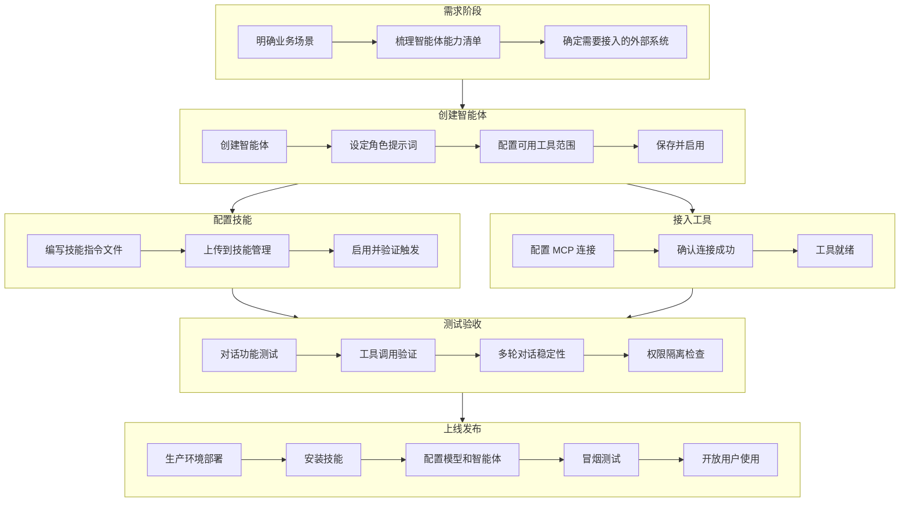
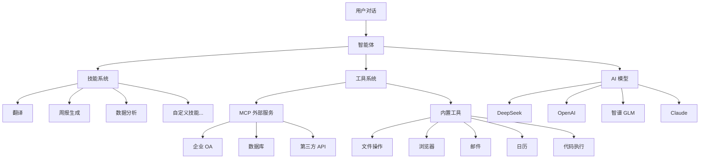

# AgentOS 智能体开发流程

> 本文档面向产品、运营及项目管理人员，介绍在 AgentOS 平台上开发智能体的完整流程。

---

## 一、整体流程概览

在 AgentOS 中，构建一个完整的智能体应用通常包含以下环节：

### 主流程


### 详细流程



### 各步骤说明

| 步骤          | 做什么                   | 谁来做            | 产出物        |
| ------------- | ------------------------ | ----------------- | ------------- |
| 1. 需求定义   | 明确智能体要解决什么问题 | 产品/业务         | 需求文档      |
| 2. 创建智能体 | 配置角色、提示词、权限   | 产品/管理员       | 智能体配置    |
| 3. 配置技能   | 编写智能体的"行为指令"   | 产品/提示词工程师 | SKILL.md 文件 |
| 4. 接入工具   | 让智能体能调用外部系统   | 开发/集成工程师   | MCP 服务      |
| 5. 测试验收   | 对话测试、功能验证       | 测试/产品         | 测试报告      |
| 6. 上线发布   | 打包部署、权限审批       | 运维/管理员       | 正式环境可用  |

### 平台能力全景




---

## 二、创建智能体

### 什么是智能体？

智能体是用户直接对话的"角色"，它由以下部分组成：

```
智能体 = 角色设定 + 技能 + 工具 + AI 模型（管理员配置）
```

- **角色设定**：决定智能体"是谁"、"怎么说话"
- **技能**：决定智能体"会做什么"（下一章节详述）
- **工具**：决定智能体"能连接什么系统"（第三章节详述）
- **AI 模型**：智能体的"大脑"，由管理员统一配置，用户无需关心

### 配置方式

**方式一：管理后台配置（推荐）**

在管理后台的"智能体管理"页面：

1. 点击"创建智能体"
2. 填写名称、描述、头像
3. 编写系统提示词（角色设定）
4. 配置可用工具范围
5. 保存

> ℹ️ AI 模型由管理员在后台统一配置，用户对话时直接使用已配置好的模型，无需也无法自行选择。

**方式二：文件配置**

在服务器目录 `~/.agentos/agents/智能体名/` 下放置：

- `agent.yaml` — 基本配置（名称、工具白名单）
- `prompt.md` — 角色提示词

**方式三：对话中创建**

直接在聊天中告诉系统："帮我创建一个XX智能体，它的职责是……"

### 模型配置（管理员操作）

AI 模型由管理员在管理后台统一配置和维护，用户无需关心模型选择。管理员可根据业务需要随时切换：

| 模型       | 特点                 |
| ---------- | -------------------- |
| DeepSeek   | 中文能力强，性价比高 |
| OpenAI GPT | 综合能力强           |
| 智谱 GLM   | 国产大模型           |
| Claude     | 长文本处理优秀       |


---

## 三、技能配置（Skill）

> 技能是智能体的"行为指令"，决定智能体在特定场景下"怎么做"。

### 什么是技能？

技能就是给智能体写的 **"操作手册"**。比如你希望智能体会"翻译"、"写周报"、"做数据分析"，就给它写一份对应的技能文件。

**特点：**

- 不需要写代码，用自然语言描述即可
- 一个技能 = 一个 Markdown 文件
- 智能体会在合适的时机自动调用对应技能

### 操作步骤

**第 1 步：编写技能文件**

创建一个 `SKILL.md` 文件，内容分两部分：

| 部分     | 内容                  | 示例                                            |
| -------- | --------------------- | ----------------------------------------------- |
| 头部信息 | 技能名称 + 一句话描述 | 名称：`weekly-report`，描述：帮助用户生成周报 |
| 正文指令 | 告诉智能体具体怎么做  | 步骤 1、步骤 2、输出格式要求…                  |

**第 2 步：上传到系统**

有两种方式：

- **方式 A**：将文件放入服务器的技能目录 `~/.agentos/skills/技能名/SKILL.md`
- **方式 B**：在管理后台的"技能管理"页面，将技能打包为 ZIP 后上传

**第 3 步：验证生效**

重启服务或刷新后，在"技能管理"页面确认技能已出现在列表中，状态为"已启用"。

**第 4 步：对话测试**

在聊天窗口输入与技能描述相关的话，观察智能体是否按预期执行。

### 技能脚本支持

除了纯文字指令，技能还可以 **携带可执行脚本**，让智能体在安全沙箱中运行 Python 或 JavaScript 代码，完成更复杂的任务。

**适用场景：**

- 数据清洗、格式转换
- 调用特定算法或计算逻辑
- 生成图表、报告文件
- 批量处理结构化数据

**带脚本的技能目录结构：**

```
my-skill/
├── SKILL.md              # 技能指令（必须）
├── manifest.json         # 脚本声明清单（有脚本时必须）
├── scripts/              # 可执行脚本
│   ├── analyze.py        # Python 脚本
│   └── transform.js      # JavaScript 脚本
├── assets/               # 静态资源（模板、配置等）
│   └── template.xlsx
└── references/           # 参考文档
    └── api-spec.md
```

**manifest.json 示例：**

```json
{
  "name": "data-analysis",
  "version": "1.0.0",
  "type": "bound",
  "description": "数据分析技能",
  "scripts": {
    "analyze": {
      "file": "scripts/analyze.py",
      "language": "python",
      "description": "对输入数据进行统计分析并输出报告"
    }
  }
}
```

**工作原理（无需理解技术细节）：**

```
用户提出需求 → 智能体匹配到技能 → 技能指令告诉智能体"调用哪个脚本"
→ 脚本在安全沙箱中自动执行 → 结果返回给用户
```

> ℹ️ 脚本在隔离的沙箱环境中运行，不会影响服务器安全。用户无需关心脚本如何执行，只需用自然语言描述需求即可。

**技能类型说明：**

| 类型                  | 说明                   | 触发方式                     |
| --------------------- | ---------------------- | ---------------------------- |
| `dynamic`（动态型） | 默认类型，所有对话可用 | 用户说话匹配关键词时自动触发 |
| `bound`（绑定型）   | 绑定到特定智能体       | 创建智能体时指定绑定         |

### 技能管理界面

在管理后台可以：

- ✅ 查看所有已安装技能
- ✅ 启用 / 禁用某个技能
- ✅ 上传新技能（ZIP 包，可含脚本）
- ✅ 删除自定义技能

---

## 四、MCP 工具接入

> MCP 工具是智能体的"双手"，让智能体能操作外部系统。

### 什么是 MCP？

MCP（Model Context Protocol）是一种让智能体 **调用外部系统** 的标准协议。

简单理解：技能告诉智能体"怎么想"，MCP 工具让智能体"能动手"。

**举例：**

- 接入企业 OA → 智能体可以查审批、提流程
- 接入数据库 → 智能体可以查询业务数据
- 接入日历服务 → 智能体可以创建会议、设提醒

### 操作步骤

**第 1 步：准备 MCP 服务**

由开发人员部署一个 MCP 服务器（可以是本地程序，也可以是远程服务）。

**第 2 步：在管理后台添加**

进入管理后台 → "MCP 管理" 页面 → 点击"添加服务器"，填写：

| 填写项   | 说明                | 示例                              |
| -------- | ------------------- | --------------------------------- |
| 名称     | 给这个连接起个名字  | `公司OA系统`                    |
| 连接方式 | 本地程序 / 远程地址 | 远程地址                          |
| 地址     | MCP 服务的访问地址  | `http://192.168.1.100:8080/mcp` |

**第 3 步：确认连接成功**

添加后，页面会显示连接状态为"已连接"，并列出该服务提供的所有工具。

**第 4 步：对话验证**

在聊天中尝试使用对应功能，例如："帮我查一下本周的审批单"。

### MCP 管理界面

在管理后台可以：

- ✅ 查看所有 MCP 服务器及连接状态
- ✅ 添加 / 移除服务器
- ✅ 重启 / 断开连接
- ✅ 查看每个服务器提供的工具列表
- ✅ 实时查看 MCP 运行日志


---

## 五、测试验收

### 测试要点

| 测试项     | 验证内容                             | 通过标准       |
| ---------- | ------------------------------------ | -------------- |
| 技能触发   | 说相关的话，智能体是否按技能指令执行 | 正确执行步骤   |
| 工具调用   | 让智能体使用 MCP 工具                | 返回正确结果   |
| 角色一致性 | 多轮对话中是否保持角色设定           | 不跑偏、不混乱 |
| 异常处理   | 输入无关/错误内容                    | 礼貌拒绝或引导 |
| 权限隔离   | 不同用户数据是否隔离                 | 互不可见       |

### 测试方法

1. 在 Web 聊天界面新建对话
2. 选择目标智能体
3. 按测试用例逐条输入
4. 记录回复是否符合预期
5. 查看管理后台的对话日志确认工具调用详情


---

## 六、上线发布

### 发布检查清单

- [ ] 所有技能已上传并启用
- [ ] MCP 服务器连接正常
- [ ] 智能体配置完成（角色、工具）
- [ ] 测试用例全部通过
- [ ] 用户权限已分配
- [ ] 生产环境模型 API Key 已配置

### 上线步骤

1. **打包**：将技能打包为 `.zip`
2. **部署**：运维在生产环境部署 AgentOS 服务
3. **安装**：管理员在后台上传技能
4. **配置**：配置模型、创建智能体、连接 MCP
5. **验证**：在生产环境执行冒烟测试
6. **开放**：分配用户权限，通知用户使用


---

## 七、各角色职责一览

| 角色                   | 负责内容                               |
| ---------------------- | -------------------------------------- |
| **产品/业务**    | 需求定义、技能指令编写、验收测试       |
| **提示词工程师** | 编写和优化 SKILL.md、智能体提示词      |
| **开发工程师**   | MCP 服务开发、系统部署                 |
| **管理员**       | 后台配置、模型管理、权限审批、上线操作 |
| **测试**         | 功能测试、对话测试、回归测试           |

---

## 附：常见问题

| 问题             | 解答                                                   |
| ---------------- | ------------------------------------------------------ |
| 技能没有生效？   | 检查技能是否已启用；描述中的关键词是否和用户说的话匹配 |
| MCP 工具调不动？ | 检查 MCP 服务器连接状态是否为"已连接"                  |
| 智能体回答跑偏？ | 优化系统提示词，明确角色边界和输出格式                 |
| 想换一个模型？   | 联系管理员在后台"模型管理"中切换，无需重启             |
